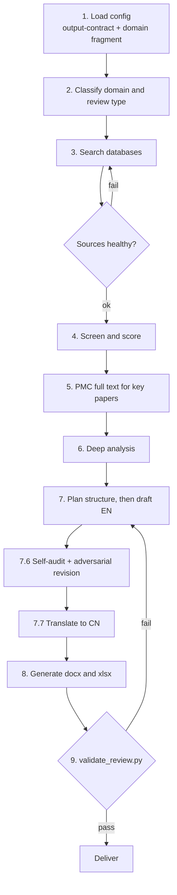

# Review generator

Create a bilingual (Chinese + English) research review from the user's topic. The review must be evidence-grounded with verified citations, following the writing standards of Nature Reviews journals and other high-impact review venues.

## Core philosophy

A high-quality review is **secondary research with independent analytical contribution**, not a paper compilation. It must deliver original insights that go beyond summarizing published work. Quality is calibrated against the editorial standards of Nature Reviews journals, Science review articles, Cell review issues, the Trends in... series, and Annual Reviews. The review must:

- Provide original synthesis that identifies patterns, contradictions, and gaps across the literature
- Compare and evaluate methods, findings, or approaches, not merely describe them
- Construct a logically self-contained argument that advances the reader's understanding of the field
- Read as a compelling narrative with forward momentum, not an encyclopedia entry

**Execution principle**: Never pause, never ask the user for confirmation. This skill runs end-to-end without interruption. Make every decision autonomously and proceed. If context is running out, launch a Task-tool subagent to continue; do NOT stop and wait. When in doubt between two valid options, pick the faster/more conservative one silently.

**Script execution rule**: All pipeline scripts (`multi_db_search.py`, `filter_relevant.py`, `analysis_skeleton.py`, `renumber_citations.py`, `validate_review.py`, `generate_docx.py`) are pre-existing in `<skill-root>/scripts/`. Do NOT generate, copy, or recreate them in the working directory. Always run them with `python <skill-root>/scripts/<name>.py`; never with a bare filename or a relative path that would copy them.

**Prerequisites**:
```powershell
pip install requests openpyxl python-docx
```

**Delegation constraint**: Subagents start with blank context and do NOT inherit skill reference files. Never delegate full-document drafting or rewriting to a subagent unless you copy ALL applicable formatting rules into the prompt. Subagents are safe for bounded mechanical tasks: literature search, paper screening, metadata extraction, comparison table generation from structured data. Prose generation that must comply with writing-quality.md standards must be done by the primary agent.

**Default assumptions** (apply automatically; do not ask for confirmation):
- Review type: Comprehensive/Narrative
- Language: Bilingual (English + Chinese)
- Citation style: Vancouver sequential
- Output: Full package (.md + .docx + .xlsx)
- Date range: No artificial limit (search all years, prioritize recent)
- Preprints: Excluded for biomedical/cross/general; allowed but marked for CS/AI

## File routing

Routing is inline; there is no separate manifest. Two axes apply.

**Domain**: classify the topic from its evidence base, then load only the matching fragment:

| Domain | Fragment |
|--------|----------|
| `biomedical` | `fragments/domain-biomedical.md` |
| `cs_ai` | `fragments/domain-cs-ai.md` |
| `cross` | `fragments/domain-cross.md` |
| `general` | `fragments/domain-general.md` |

**Language**: always generate both Chinese and English documents.

**Always loaded**: `standards/output-contract.md`. Every other reference is loaded at the workflow step listed in the Reference files table at the end of this file.

## Task flow



The diagram is a map, not a checklist: the numbered steps below are the authoritative procedure, and step 3 is re-entered with `--resume` rather than restarted.

### 1. Load configuration
Read `standards/output-contract.md`, then the domain fragment selected in step 2.

### 2. Classify and determine scope
Classify the topic as `biomedical`, `cs_ai`, `cross`, or `general`; read only the matching domain fragment from `fragments/`.

**Template selection (MANDATORY: DO NOT ASK)**:
- `biomedical` or `cross` (including AI+biomedical): default **Comprehensive/Narrative**. SOTA is allowed when the cross-domain topic is method-heavy AND the target venue is a CS/AI conference.
- `cs_ai` with method/taxonomy focus: may use **SOTA**
- User explicitly says "systematic review" / "meta-analysis": use **Systematic**
- User explicitly says "perspective" / "rethinking" / "critical analysis": use **Critical/Perspective**
- Default (user says "综述", "review", "overview", "survey" without specifying): **Comprehensive/Narrative**

**State your detection** briefly: domain, review type, and template choice. Do NOT ask for confirmation.

### 3. Search the literature
Read `guides/database-guide.md` for database coverage, query syntax, API details, and `multi_db_search.py` invocation.

Create `./<topic_slug>/` per `standards/output-contract.md` §Folder structure rules. Build 2-5 query groups, log to `<topic_slug>/candidates/search_queries.md`, run `multi_db_search.py`. Import user-supplied literature if provided.

If the run is interrupted, or a source fails with RG-400/RG-201, re-run the identical command with `--resume`: completed topic and database pairings are skipped, and their articles are carried over. Never restart a long search from scratch.

### 4. Screen, assess, and select references
Read `standards/scoring-system.md` for the six-dimension scoring system and `filter_relevant.py` two-pass workflow. Read all abstracts, score each paper, sort by total, select top N (per template target), validate theme coverage. Run the post-screening quality gate in `standards/scoring-system.md` §Post-screening quality gate.

### 5. PMC full-text retrieval (for critical papers)
See `guides/database-guide.md` §PMC (PubMed Central): full-text retrieval for qualification criteria and API details.

### 6. Deep analysis of selected literature
Read and follow `guides/deep-analysis.md`. Execute `analysis_skeleton.py` (see deep-analysis.md for command), merge PMC notes into `analysis_output.md`, then delete `_pmc_notes.md`. Run the full deep analysis framework. All output goes to `<topic_slug>/analysis_output.md`. Run the deep-analysis quality gate in `guides/deep-analysis.md` §Deep-analysis quality gate.

### 7. Plan and draft
Writing order: body first, abstract last. Write `review_EN.md` gradually, appending sections as completed.

#### 7.1 Pre-drafting setup
Read `standards/citation-formats.md`, `standards/writing-quality.md`, `standards/sequential-citation.md`, and the relevant template file in `templates/` alongside `templates/structure-common.md`. Pay particular attention to writing-quality.md §2 (paragraph structure and forbidden patterns), §3 (global writing rules), §3.5 (tone and academic register), and §10 (narrative-review quality appraisal).

Extract 3-6 themes from analysis_output.md clustering results. Write a provisional abstract (80-120 words) to `_provisional_abstract.md`. Create `glossary.md`.

**🔴 CRITICAL: Create `review_EN.md` with complete structure skeleton FIRST, before drafting any prose.**

The section structure is defined by the selected review-type template, NOT hardcoded here. Read the template loaded in step 7.1 (`templates/template-narrative.md`, `template-sota.md`, `template-critical.md`, or `template-systematic.md`) and copy its `## Overall structure` block as the skeleton, converting every section title into a unique `_TBD` placeholder. The front matter and References use the fixed placeholders below; the body headings come from the template.

Use FINAL-OUTPUT-COMPATIBLE format (plain text, no blockquotes, no `...`):
```markdown
# TITLE_TBD

ABSTRACT_TBD

Keywords: KEYWORDS_TBD

KEY_POINTS_TBD

ABBREVIATIONS_TBD

## 1. Introduction

INTRODUCTION_TBD

## 2. SECTION_1_TBD   ← one H2 per body section named in the template's Overall structure

SECTION_1_CONTENT_TBD

## N. OUTLOOK_TBD   ← final body section (systematic reviews use Conclusions)

OUTLOOK_TBD

## References

REFERENCES_TBD
```

Each placeholder must be UNIQUE so the agent can replace it individually. Do NOT use `...` or other identical markers.

The body H2 set is taken from the template's `## Overall structure` and is content-driven: for Narrative/SOTA/Critical, derive themes from the deep-analysis clustering (typically 3–6); a topic with fewer natural themes uses fewer sections, and a single coherent narrative may be written as continuous prose with H3 sub-headings instead of forced H2 sections. The template, not this step, is the structural authority; see `templates/structure-common.md` §Flexibility. Add or drop `SECTION_K_TBD` placeholders to match the template and your clustering; renumber the Outlook/Conclusions heading so it follows the last theme.

KEY_POINTS_TBD is the Key points block (4–6 bullets, zero citations): mandatory for Narrative/SOTA, recommended for Critical, not used for Systematic; fill it after the body is drafted (see structure-common §Key points and Boxes). ABBREVIATIONS_TBD is the abbreviations table, inserted only when ≥10 abbreviations are used (step 7.5); delete this line otherwise.

After drafting each body section, replace its placeholder with actual prose. The front matter (title, abstract, keywords) is filled in during step 7.5.

**Final-section naming (MANDATORY)**: The last substantive section of a narrative, SOTA, or critical review is titled **Outlook** in English and **展望** in Chinese. Do NOT title it "Conclusion", "Conclusions", "Discussion", or "结语/结论/小结". A review is secondary research, and a Conclusion heading falsely implies that the article reports original findings. Systematic reviews are the sole exception: PRISMA requires a Conclusions section, so keep "Conclusions" there. The section is a single integrated unit that synthesizes the field's standing problems and traces forward-looking research routes; it must not be split into separate "Discussion" and "Future directions" chapters.

#### 7.2 Draft body into review_EN.md
Follow the **drafting order** subsection in your selected template file.

**Citation rules (MANDATORY)**:
- Append every reference to the `## References` section using the exact format from `standards/citation-formats.md` (Vancouver sequential); do NOT leave references empty
- Every factual claim in the body MUST include a `[[ref_no]]` temporary citation marker from `selected_papers.json`
- Example: `Single-cell RNA-seq has transformed our understanding of tumor heterogeneity [[3],[5],[12]].`
- The `ref_no` field in `selected_papers.json` maps directly to the temporary number; use it
- **Any paragraph with zero citations is forbidden**: each paragraph must cite at least one reference
- **Synthesis, not a citation log**: major claims, consensus trends, and comparative statements must be backed by multiple papers (e.g., `[23-26]`); a review where every citation is a lone `[N]` is a catalog, not a synthesis. The review must analyze the literature, not merely report it, and must never narrate its own structure (e.g., "each section builds on the previous one") or prefix a list with a meta-sentence like "this review integrates the following evidence:". See writing-quality.md §2.2 and §2.4.
- **Complete metadata is mandatory**: every reference entry must carry authors, title, journal or venue, publication year, and a persistent identifier (DOI, PMID, arXiv ID, or URL); books, theses, patents, websites, and datasets follow their type format in `standards/citation-formats.md`. `validate_review.py` checks each entry and reports gaps as RG-300. Fill missing fields from the database record in `selected_papers.json`; if a field cannot be completed, remove the entry entirely and re-run renumbering.

Draft the body yourself: subagents lack the writing-quality.md rules. After drafting each section, **replace its placeholder in `review_EN.md`** with the actual prose using the `edit` tool; match the unique placeholder text to target the right location.

#### 7.3 Renumber references
See `standards/sequential-citation.md` §Renumbering workflow. Run:
```powershell
python <skill-root>/scripts/renumber_citations.py --input-dir "./<topic_slug>"
```
Verify all three post-script checks pass, check reference list format.

#### 7.4 Citation accuracy verification
See `standards/sequential-citation.md` §Citation accuracy verification. Verify every quantitative claim and spot-check at least 30% of the remaining citations; fix issues, re-run renumbering if citations changed.

#### 7.5 Write final abstract, key points, keywords, abbreviations, title
Rewrite the abstract to `standards/writing-quality.md` §4.1: 150-250 words, up to 300 for broad comprehensive and SOTA reviews. This English length is the hard constraint. The Chinese abstract is a faithful rendering of the English one; its length emerges from translation (typically 250–400 字, about 450 字 for broad comprehensive and SOTA reviews) and is not independently capped. **ZERO citations** in the abstract. Write 5–8 keywords per §4.2.

**EN Key points**: Draft the Key points block (4–6 bullets, zero citations) and replace the `KEY_POINTS_TBD` placeholder in `review_EN.md`. Mandatory for Narrative/SOTA, recommended for Critical, not used for Systematic (see `templates/structure-common.md` §Key points and Boxes). The Chinese `review_CN.md` gets a matching Key points block in the same position. Fill this block after the body is drafted, since it states the review's main messages.

**List notation (MANDATORY)**: every bullet in either review_*.md file is written as a Markdown list item, that is a hyphen followed by one space and then the takeaway on the same line (`- Single-cell RNA-seq shifts the unit of drug discovery from the gene to the cell state`). Never type the glyph `•` or any other bullet character into the draft. The docx exporter turns the Markdown marker into a Word bullet; a hand-typed glyph stays body text, so Word wraps the continuation lines back to the margin and the item reads as a broken line. `validate_review.py` reports a hard-coded glyph as RG-304. The Chinese Key points render in 楷体 (KaiTi), which the exporter sets automatically; do not switch the font by hand.

**EN Abbreviation table**: Count distinct abbreviations used in the English body. If ≥10, insert an abbreviation table between Keywords and Introduction in `review_EN.md`:

```
## Abbreviations

| Abbreviation | Full Form |
|-------------|-----------|
| HR | homologous recombination |
| NHEJ | non-homologous end joining |
| ... | ... |
```

This is the English-only counterpart to the CN abbreviation table (which has three columns with Chinese). Both tables share the same abbreviations and appear at the same position in their respective documents.

File assembly at top of `review_EN.md` per `standards/writing-quality.md` §4.1-4.3. Delete `_provisional_abstract.md`.

#### 7.6 English draft self-audit
Run the full self-audit from `standards/writing-quality.md` §9. Fix all issues before proceeding.

**Then run the adversarial revision pass (MANDATORY).** Self-audit checks compliance; it does not test whether the argument holds. Adopt the stance of a hostile reviewer for the target venue and attack your own draft: this pass exists to **harden and defend** the review's conclusions against counter-evidence, not to erase them. A defensible, well-evidenced thesis is the goal; do not retreat into a timid, claim-free summary.

1. **Falsification attempt**: State the review's central thesis in one sentence, then list the three strongest pieces of evidence in the draft that could overturn it. If genuine counter-evidence exists, engage it explicitly in the text (qualify the claim, bound its scope, or show why it does not generalize); do not silently delete the thesis. Only retreat from a conclusion if the evidence against it is overwhelming.
2. **Source-of-claim stress test**: Pick the 5 most quantitative or most surprising claims. For each, confirm the cited paper actually reports it. Remove or soften any claim traceable only to inference.
3. **Constructed-methodology check**: Scan every sentence that evaluates a study's design, sample, or statistics. Confirm each such detail is present in the source. Delete any methodological criticism that was inferred rather than read.
4. **Redundancy and mono-rhythm scan**: Flag any two consecutive paragraphs that share the same internal shape, and any section whose paragraphs are uniformly sized. Vary structure where the argument allows.
5. **Alternative-explanation check**: For each major conclusion, ask what a competing interpretation would predict and whether the draft acknowledges it.

Record the outcome in the output notes (issues found, changes made). Do not proceed to translation until this pass is complete.

#### 7.7 Translate to Chinese (review_CN.md)
Read `standards/zh.md`. Create `review_CN.md` as natural Chinese academic prose.

**Abbreviation handling (MANDATORY: two distinct deliverables):**

**(A) In-text abbreviation format in review_CN.md:**
On **first appearance in EACH section** (abstract + every body section), every abbreviation MUST follow:
`中文全称（English full name，缩写）`

Apply this to ALL abbreviations including: gene names (BRCA1, TP53), proteins (ATM, ATR), pathways (NER, BER, HR, NHEJ), techniques (PCR, RNA-seq, ChIP), diseases (AD, PD), and any domain-specific acronym. After first use in each section, use the abbreviation alone.

✅ `同源重组（homologous recombination，HR）` | ❌ `同源重组（HR）`
✅ `核苷酸切除修复（nucleotide excision repair，NER）` | ❌ `NER（核苷酸切除修复）`

**(B) Abbreviation table in review_CN.md:**
After writing the full Chinese text and applying the in-text abbreviation rule, count distinct abbreviations. If ≥10, insert an abbreviation table between Keywords and Introduction:

```
## 缩略词表

| 缩略词 | 中文全称 | 英文全称 |
|------|---------|---------|
| HR | 同源重组 | homologous recombination |
| NHEJ | 非同源末端连接 | non-homologous end joining |
| ... | ... | ... |
```

This is SEPARATE from `glossary.md` (which covers all bilingual terminology, not just abbreviations). The abbreviation table lives inside review_CN.md; glossary.md is a standalone file.

Run zh.md's translation verification checklist. Pay special attention to checklist item "Every Chinese abbreviation follows 中文全称（English full name，缩略词）on first use in each section." Scan EVERY section in review_CN.md and verify this rule before finalizing.

#### 7.8 Optional figure generation
Figures enhance a review but are **not required** for auto-generation: the pipeline operates on text metadata (abstracts, DOIs) and lacks original paper images. Generate figures only when ALL of these hold:
1. You have access to a text-to-image or diagramming model/tool
2. The domain is CS/AI/engineering where architecture or taxonomy diagrams are feasible from text alone
3. You can produce publication-quality output (colorblind-safe, vector or high-res PNG)

**For systematic reviews only**: Generate a **text-based PRISMA flow diagram** as a Mermaid code block in `analysis_output.md` (no image model needed). Show: records identified → duplicates removed → screened → excluded → full-text assessed → excluded → included.

If figures are created, place them in `<topic_slug>/figures/` and reference in markdown via ``. The docx generator (`generate_docx.py`) will auto-embed existing images.

If figures are NOT created:
- Add `[Figures: not generated (text-format pipeline)]` to the output notes
- Keep the review text's figure references as `[Figure: ...]` placeholders; the review stands on its own without visuals

### 8. Generate output documents
See `standards/output-contract.md` §Script commands for `generate_docx.py` invocation.
```powershell
python <skill-root>/scripts/generate_docx.py --input-dir "./<topic_slug>" --final-xlsx
```

### 9. Validate and deliver: HARD GATE
See `standards/output-contract.md` §Validation workflow for the full Steps A-D procedure. Run:
```powershell
python <skill-root>/scripts/validate_review.py --input-dir "./<topic_slug>" --verify-renumbering
```
You MUST pass with `Review validation passed` before reporting completion.

Report to user: domain, review type, databases, reference count, structural choices, figures/tables, any issues resolved. For clinical/medical topics, include: "This review is for academic research reference only and does not constitute clinical guidance."

## Reliability, error codes, and resume

Every pipeline script reports failures with a stable code and a non-zero exit code, so a failure class can be identified without parsing prose. Diagnostics go to **stderr** as `ERROR [RG-xxx] <message>` (optionally followed by a `HINT:` line); progress and results go to **stdout**.

| Code | Meaning | Exit |
|------|---------|------|
| RG-000 | success | 0 |
| RG-100 | usage or environment error (bad flag, missing dependency) | 2 |
| RG-101 | missing or unreadable input file or directory | 2 |
| RG-102 | malformed input data (for example invalid JSON) | 2 |
| RG-103 | value outside the permitted range | 2 |
| RG-200 | every data source failed | 3 |
| RG-201 | partial data-source failure (warning) | 0 |
| RG-202 | result count below threshold (warning) | 0 |
| RG-203 | `--strict` escalation of RG-201/RG-202 | 3 |
| RG-300 | output-contract violation | 1 |
| RG-301 | missing or empty deliverable | 1 |
| RG-302 | readability contract violation (sentence rhythm, paragraph size, parenthetical load) | 1 |
| RG-303 | writing-style advisory (superlative budget, commentary openers, unsupported claims) | 0 |
| RG-304 | list-format violation (hard-coded bullet glyph, Key points block rules) | 1 |
| RG-400 | remote API failed after all retries (per source; reclassified as RG-200 or RG-201) | 3 |
| RG-500 | unexpected internal error | 1 |

**Retry**: `multi_db_search.py` wraps every database call in exponential backoff with jitter (`--max-attempts`, default 4). Persistent remote failures surface as RG-400 and are then classified as RG-200 (all failed) or RG-201 (partial).

**Resume** (never restart a long search from scratch):
- `multi_db_search.py` checkpoints to `<topic_slug>/search_progress.json` after every (topic, database) pair. Re-run the identical command with `--resume` to skip completed pairs and retry only the failed ones; previously found articles are carried over.
- `filter_relevant.py --resume` skips the step when `selected_papers.json` and `.xlsx` are already current for the given `--input`; `--force` overrides the check.

**Machine-readable reports**: pass `--error-report <path>` to any of the three scripts to persist the collected issues as JSON.

**Strict mode**: `multi_db_search.py --strict` makes partial source failure fatal (exit 3) instead of a warning. Use it when a complete source set is mandatory.

## Failure handling
- If no usable literature is retrievable, broaden queries and add databases; record the issue in the output notes and proceed with what is available. Never write with invented references.
- If a single search returns >500 candidates, automatically narrow by adding qualifiers.
- Keep API keys in environment variables (`NCBI_API_KEY`, `SEMANTIC_SCHOLAR_API_KEY`, `DIMENSIONS_API_KEY`, `IEEE_API_KEY`); never in code or output. Keys are optional: databases work at basic rate limits without them.
- Selected papers containing any preprint (biomedical/cross/general domains): remove immediately, 0% tolerance. Check `selected_papers.json` for `source: "Preprints.org"`, `journal: "bioRxiv"`, `journal: "medRxiv"`, and similar.
- Never leave placeholder references: `[AUTHOR_INPUT_NEEDED]`, `METADATA_MISSING`. Either fill real metadata or remove the entry entirely.
- When full-text retrieval fails, use the abstract; it is sufficient for the 9-field extraction.
- If a subagent produced malformed output, such as abstract citations, mixed bracket formats, or hallucinated references, discard the subagent-generated prose and re-draft it yourself. Only citation renumbering is safe for automated text replacement.

## Reference files
| When | File |
|------|------|
| Before search | `guides/database-guide.md` |
| During screening: paper scoring | `standards/scoring-system.md` (six-dimension weighted scoring) |
| Before writing reference list | `standards/citation-formats.md` |
| During drafting: citation workflow | `standards/sequential-citation.md` |
| Before drafting: structure | `templates/structure-common.md` + `templates/template-*.md` |
| After screening: quality QC | `standards/scoring-system.md` §Post-screening quality gate |
| After analysis: quality QC | `guides/deep-analysis.md` §Deep-analysis quality gate |
| Before/ during drafting: quality | `standards/writing-quality.md` (standards, self-audit §9, narrative-review appraisal §10) |
| Between screening and drafting | `guides/deep-analysis.md` (analysis framework) |
| Before drafting: raising quality | `guides/best-practices.md` |
| Before translating | `standards/zh.md` (Chinese adaptation) |
| After translating, before docx generation | `templates/structure-common.md` §Figure specifications (figure rules, optional in auto-pipeline) |
| During figure creation (optional) | Load `scientific-schematics` or `scientific-visualization` skill |
| Any time a step fails or is ambiguous | `FAQ.md` (review-type selection, troubleshooting, error codes) |
| When a step's concrete form is unclear | `examples/` (synthetic P1-P5 walkthrough of the full pipeline) |
| Error-handling internals (shared by three scripts) | `scripts/_errors.py` (codes, exit codes, retry, guarded main) |
| Always loaded | `standards/output-contract.md` |
